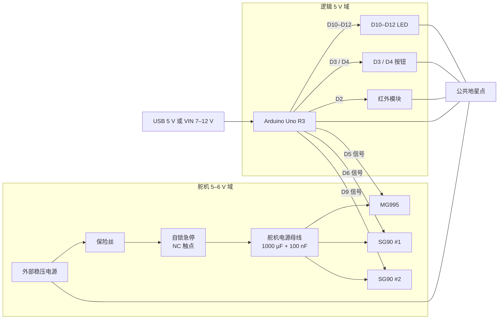

# TrebuchetController 接口与接线规范

- 文档版本：v3.0（接口冻结基线）
- 控制板：Arduino Uno R3（ATmega328P，5 V 逻辑）
- 当前硬件：2× SG90 9g 微型舵机、1× MG995 高扭矩舵机、1× HW-870 红外模块
- 当前固件：v0.1 监测与安全骨架，不驱动舵机
- 本文范围：引脚分配、电源与保护、连接器与线束、子系统接线、固件接口契约、BOM、上电调试
- 本文不包含：机械结构、自动装填/解锁/发射逻辑、PCB 布线、安全认证

> **安全底线**
>
> 1. 软件停止、串口命令、LED 指示都不能替代能切断执行器电源的实体急停/断电装置。
> 2. 舵机必须使用独立、稳压、按峰值电流选型的电源，不得由 Uno 的 5V 引脚供电。
> 3. 调试和接线时必须卸载弹丸、释放机械储能，并确保机构不会夹伤人员。
> 4. 本文是设计规范，不是已经完成的实物验证；所有电压、电流、极性和机械限位都必须按实物核对。

**验证状态（2026-10-29）**

- 固件：`arduino-cli` 编译通过，3430 B Flash（10%）、257 B RAM（12%）；尚未烧录到实板。
- 硬件：已确认型号为 2× SG90、1× MG995、1× HW-870、1× Sensor Shield V5.0；尚未完成实物接线与测量。文中电源容量、保险丝和线径按这些型号的典型/保守值设计，最终值必须按实物铭牌和实测修正。
- 接口：v3.0 已冻结；引脚、V5.0 排针位置和固件常量以本文第 3.1、6.7.5、7.1 节为准，任何改动先改本文，再同步 `config.h` 和 README。
- SG90 与 MG995 的堵转电流存在批次/克隆差异，尤其 MG995 可能从约 1.2 A 到 2.5 A 不等；本文按 2.5 A 保守估算。必须实测启动/堵转电流后复核保险丝和电源。
- v0.1 固件只实现红外监测、状态机、软件故障锁定和串口遥测；按钮、外部 LED、舵机均未实现。

### 已确认硬件

| 器件 | 型号 / 规格 | 数量 | 用途 |
|---|---|---|---|
| 控制板 | Arduino Uno R3 | 1 | 5 V 逻辑主控 |
| 微型舵机 | SG90 9g | 2 | 轻负载/辅助动作 |
| 标准舵机 | MG995 高扭矩 | 1 | 主负载/投掷机构 |
| 红外模块 | HW-870 | 1 | 5 V 数字输出，2–30 cm 可调，常见低有效 |
| 扩展板 | Sensor Shield V5.0（Uno 3 针 G/V/S） | 1 | 无源转接板；仅走信号/小电流，舵机电源不经过 V 排针 |

> **接口基线（v3.0）**：第 3.1 节引脚表、第 6.7.5 节 V5.0 实物排针定位、第 7.1 节固件常量是唯一接口约定；三者必须同步。README 只做速查，不另立一套接法。

---

## 1. 设计目标与边界

这一版要解决的是“接口不确定”而不是“功能越多越好”。目标是把下面几件事定死：

1. 每个信号接 Uno 的哪个引脚、方向、有效电平是什么。
2. 逻辑电源和舵机电源如何分开，地如何共，电流走哪条路径。
3. 急停、保险丝、滤波电容、上拉/下拉电阻放在哪里。
4. 连接器怎么选、线怎么走、上电顺序是什么。
5. 固件与硬件之间的契约：引脚常量、脉宽范围、状态机、故障行为。
6. 上电前检查什么、分级调试怎么测、什么算通过。

明确不做的事情：

- 不设计自动装填、自动解锁或自动发射逻辑。
- 不在这一版驱动舵机；只把舵机接口、供电和保护预留完整。
- 不把软件故障锁定宣传成“安全急停”。
- 不声称本文的电路已经过实物验证或安全认证。

---

## 2. 系统框图

### 2.1 逻辑框图



> 图中只画信号和电源主干，舵机地线也回到公共地星点（省略未画）。接线以第 4、5 节的网络表和子系统图为准。

### 2.2 电源树

```text
外部 5–6 V 电源 +
  └─ 保险丝 ── 急停(NC, 自锁) ──┬─ Servo 1 +
                                ├─ Servo 2 +
                                └─ Servo 3 +

外部电源 − ─────────────────────┬─ Servo 1 / 2 / 3 −
                                ├─ Arduino GND
                                ├─ 红外 GND
                                └─ 按钮 / LED GND
```

关键点：

- 逻辑 5V 和舵机 5–6V 是两个电源域，只在“公共地星点”相连。
- 舵机大电流不经过 Uno 的 5V 引脚，也不经过 Uno 的地线。
- 急停串在舵机电源正极路径上；软件故障锁定不能代替它。
- 所有地线在电源负极附近汇合，避免舵机电流在信号地线上产生压降。

---

## 3. 引脚分配

### 3.1 最终引脚表

| 功能 | Uno 引脚 | 方向 / 电平 | 外部连接 | v0.1 固件 | 备注 |
|---|---|---|---|---|---|
| 红外数字输出 | D2 | 输入，低有效（待实测确认） | HW-870 OUT 经 1 kΩ；10 kΩ 上拉；100 nF 到地 | 已实现 | `kInfraredPin = 2`；软件 30 ms 消抖 |
| 测试模式按钮 | D3 | 输入，内部上拉，按下为 LOW | 按钮另一端到 GND；可选 100 nF | 未实现 | 软件命令，不是急停 |
| 故障复位按钮 | D4 | 输入，内部上拉，按下为 LOW | 按钮另一端到 GND；可选 100 nF | 未实现 | 软件命令，不是急停 |
| 舵机 1 信号 | D5 | 输出，50 Hz，1000–2000 µs | MG995 信号；10 kΩ 下拉到 GND | 未实现 | PWM 引脚；主负载 |
| 舵机 2 信号 | D6 | 输出，50 Hz，1000–2000 µs | SG90 #1 信号；10 kΩ 下拉到 GND | 未实现 | PWM 引脚；轻负载 |
| 舵机 3 信号 | D9 | 输出，50 Hz，1000–2000 µs | SG90 #2 信号；10 kΩ 下拉到 GND | 未实现 | PWM；Servo 库占用 Timer1 时 D9/D10 的 `analogWrite` 不可用 |
| 绿色 LED | D10 | 输出，高电平点亮 | D10 → 330 Ω → LED 阳极；阴极 → GND | 未实现 | 待机 / 监测正常 |
| 黄色 LED | D11 | 输出，高电平点亮 | D11 → 330 Ω → LED 阳极；阴极 → GND | 未实现 | 测试模式 |
| 红色 LED | D12 | 输出，高电平点亮 | D12 → 330 Ω → LED 阳极；阴极 → GND | 未实现 | 故障锁定 |
| 板载 LED | D13 | 输出，高电平点亮 | 无 | 已实现 | v0.1 用作故障指示；也是 SPI SCK |
| 逻辑 5V | 5V | 电源 | 红外模块 VCC 等 | — | 不得给舵机供电 |
| 公共地 | GND | 电源 | 公共地星点 | — | 与外部舵机电源共地 |
| 外部逻辑电源 | VIN | 7–12 V | 桶形插座 | — | 不要与 USB 5V 同时硬接 |
| 预留模拟输入 | A0–A3 | 输入 | 未来传感器 / 急停辅助触点 | — | 当前未使用 |
| 预留 I2C | A4 / A5 | I2C | 未来扩展 | — | SDA / SCL |
| 串口 | D0 / D1 | UART | USB 串口 | 已用 | 不接外设，避免影响上传和诊断 |

> 舵机通道基线：D5 = MG995，D6 = SG90 #1，D9 = SG90 #2。V5.0 实物组/列位置见第 6.7.5 节。引脚本身没有型号限制，但任何调整必须先更新本文和 `config.h`。

### 3.2 Uno R3 引脚能力说明

- Uno R3 是 5 V 逻辑；ATmega328P 的输入高电平阈值约为 `0.6 × VCC = 3.0 V`。3.3 V 传感器输出通常能读为 HIGH，但余量很小，优先使用 5 V 兼容模块；否则应加电平转换。
- D0、D1 是 USB 串口，下载和串口监视都依赖它们，不接外部设备。
- D3、D5、D6、D9、D10、D11 支持 PWM；D9、D10 同时受 Timer1 影响。使用 Arduino Servo 库时，D9/D10 的 `analogWrite` 不可用；本设计 D10 只做数字 LED、D9 只做舵机信号，因此不冲突。
- D10–D13 同时是 SPI 引脚。如果以后加 SPI 显示屏或 SD 卡，需要重新规划这些引脚。
- D13 板载 LED 在 v0.1 中表示软件故障；外接红色 LED 预留在 D12。两者可以同时表示故障，也可以后续把 D13 改成心跳指示。
- A0–A3、A4/A5 当前空闲，留给未来传感器或 I2C 扩展；新增外设前先更新本表，避免重复占用。

---

## 4. 电源设计

### 4.1 两个电源域

| 电源域 | 供电来源 | 负载 | 约束 |
|---|---|---|---|
| 逻辑 5 V | USB 5 V，或 VIN 7–12 V 经 Uno 板载稳压 | Uno 本体、红外模块、按钮上拉、3 颗 LED | 总电流很小（实测应 <150 mA）；绝不能接舵机 |
| 舵机 5–6 V | 外部稳压电源 | 3 个舵机 | 按堵转电流选型；与逻辑共地；大电流不经过 Uno |

逻辑侧估算：红外模块约 20 mA，3 颗 LED 各约 9 mA，按钮上拉 <1 mA，合计 <60 mA；加上 Uno 自身，USB 500 mA 供电足够。这个估算只用于逻辑侧，不能用于舵机。

舵机侧必须独立供电：

- 不要用 Uno 的 5V 引脚给舵机供电。
- 不要用 9 V 或 12 V 直接接舵机。
- 不要把外部 5 V 电源接到 Uno 的 5V 引脚上，尤其在 USB 已经连接时。Uno 的 5V 引脚是双向的，外部 5 V 会与 USB 5 V 冲突。需要外部逻辑电源时走 VIN/桶形插座，或使用电源切换/隔离方案。
- 如果必须用同一块电池：舵机走独立的降压/稳压模块，Uno 走另一路稳压或 VIN；两路共地，但不要并联 5V。

### 4.2 舵机电源选型

舵机堵转电流远大于空载电流，电源必须按“最坏情况”选，而不是按空载十几毫安选。

本项目实际配置：2× SG90 + 1× MG995。

| 舵机 | 数量 | 单只堵转电流（保守值） | 小计 | 备注 |
|---|---|---|---|---|
| SG90 | 2 | 约 0.7 A @ 5 V | 1.4 A | 9 g 微型，塑料齿轮；只做轻负载 |
| MG995 | 1 | 约 2.5 A @ 6 V | 2.5 A | 克隆/批次差异大；主负载；必须实测 |
| 合计 | 3 | — | 3.9 A | 按 3 只同时堵转的最坏情况 |

选型公式：

```text
I_supply ≥ 1.5 × (0.7 + 0.7 + 2.5) A = 5.85 A
V_supply = 5.0 V（默认）或 6.0 V（可选，不能超过 SG90 的 6 V 上限）
```

推荐：

- **默认 5 V / 10 A 开关电源**：5 V 对 SG90 更安全，MG995 在 5 V 下扭矩仍可用；10 A 留出启动/堵转和克隆差异的余量。
- **可选 6 V / 10 A**：MG995 扭矩更大，但 SG90 额定上限就是 6 V，电源空载可能略高于 6 V，必须实测并确认不超过 6.0 V。
- **最低不要低于 5 V / 6 A**；如果实际 MG995 堵转接近 2.5 A，6 A 电源在三个舵机同时堵转时余量不足。

补充原则：

- 电源要能承受启动和堵转时的瞬时电流而不大幅掉压；否则 Uno 可能复位、舵机可能抖动。
- 电压必须用万用表在舵机端测量，不是在电源端测量；长线会掉压。
- 带过流保护/ hiccup 保护的开关电源优先；不要用手机快充头直接当舵机电源，除非确认其负载能力和保护行为。
- MG995 的堵转电流在不同资料中约 1.2–2.5 A，克隆差异很大；第一次测试必须记录单只和“三只同时动作”的峰值电流。
- 如果选 6 V 电源，先测空载电压；很多 6 V 适配器空载会到 6.3–6.5 V，对 SG90 不安全。
- 电池方案：2S 锂电（7.4 V）+ 6 V / 10 A UBEC 可行；4 节 AA 电池不适合标准舵机的大电流。
- 具体电源、连接器和保险丝最终要按舵机铭牌和实测电流定，本文给出的是设计下限。

> 典型参数参考：SG90 常见 4.8–6 V、堵转约 0.55–0.7 A；MG995 常见 4.8–7.2 V，堵转资料从约 1.2 A 到 2.5 A 不等。不同批次/克隆差异很大，最终以实测为准。

### 4.3 保护与滤波

| 项目 | 建议 | 作用 / 注意 |
|---|---|---|
| 保险丝 | 慢断型，安装在舵机电源正极入口 | 本项目 5 V / 10 A 电源建议 7.5 A 慢断，16 AWG 母线；如果改用 6 A 电源则用 5 A 慢断。保险丝保护线束，不是精密限流；最终按线材和电源说明书确认 |
| 母线电解电容 | 1000 µF / 16–25 V，低 ESR，靠近舵机电源母线 | 吸收舵机启动/换向的瞬态电流，减少掉压 |
| 高频旁路 | 100 nF 陶瓷，跨接在母线正负之间 | 抑制高频噪声；引线尽量短 |
| 急停 | 自锁、NC 触点、DC 额定，串在舵机电源正极 | 按下即断电；不能只切信号；不能由 Uno 控制 |
| 舵机信号下拉 | 每个信号 10 kΩ 到 GND | Uno 复位/断电时信号不悬空，减少舵机乱动 |
| 红外上拉 | 10 kΩ 到模块 VCC | 模块为开漏输出时必需；推挽输出可保留 |
| 红外输入滤波 | 1 kΩ 串联 + 100 nF 到 GND | 抑制尖峰和 ESD；时间常数约 100 µs–1 ms |
| 按钮滤波 | 100 nF 到 GND（可选） | 与内部上拉构成约 2–5 ms 时间常数；软件再做 30 ms 消抖 |
| LED 限流 | 330 Ω | 5 V 下约 9 mA，低于 Uno 单脚推荐 20 mA |
| 反接保护 | 极性连接器 + 保险丝；必要时加反接保护 MOSFET | 不要只靠颜色；上电前用万用表确认极性 |

### 4.4 线径建议

| 电流级别 | 建议线径 | 典型用途 |
|---|---|---|
| 信号 / 小电流 | 24 AWG | 舵机信号、按钮、LED、IR |
| 1–3 A | 20–22 AWG | 微型舵机电源 |
| 3–5 A | 18–20 AWG | 舵机电源母线 |
| 5–10 A | 16–18 AWG | 标准舵机电源母线 |

以上是短距离、单根自由空气散热的保守建议；线束捆扎、长距离、高温环境要降额。舵机电源线尽量短，信号线与电源线分开走，长距离时把信号地与信号线绞在一起。

本项目建议：舵机电源母线 16 AWG，MG995 支路 18 AWG，SG90 支路 20–22 AWG，信号 24 AWG；MG995 的 2 针电源连接器优先用 XT30 或螺钉端子，不要用杜邦线走堵转电流。

### 4.5 上电与断电顺序

上电：

1. 所有电源关闭，急停处于按下（断开）状态。
2. 接好地线、信号线、传感器和 LED；舵机先不接或卸掉负载。
3. 先给逻辑侧上电（USB 或 VIN），确认串口遥测正常。
4. 再给舵机电源上电，用万用表确认电压和极性。
5. 释放急停，先只接一个舵机做空载小角度测试。
6. 确认无复位、无过热、无异常电流后，再逐个增加舵机。

断电：

1. 先按急停，切断舵机电源。
2. 关闭舵机电源。
3. 最后关闭逻辑电源。
4. 不要在带电状态下插拔舵机或改线。

急停复位后不要自动恢复动作：应先让固件回到安全位置/中立脉宽，再人工确认后重新使能。

---

## 5. 连接器与线束

### 5.1 连接器表

| 编号 | 用途 | 建议连接器 | 引脚定义 | 备注 |
|---|---|---|---|---|
| J1 | HW-870 红外模块 | 3 针 JST-XH 或杜邦 | 1 VCC，2 GND，3 OUT | 5 V；按模块丝印核对，不按线色 |
| J2 | 测试按钮 | 2 针 JST-XH 或杜邦 | 1 D3，2 GND | 常开瞬时按钮 |
| J3 | 复位按钮 | 2 针 JST-XH 或杜邦 | 1 D4，2 GND | 常开瞬时按钮 |
| J4 | MG995 | 2 针电源 XT30/螺钉 + 1 针信号 | 电源 1 V+，2 GND；信号 SIG → D5 | 堵转按 2.5 A 级，不使用 3 针杜邦走电源 |
| J5 | SG90 #1 | 3 针 JST-XH 或杜邦 | 1 SIG → D6，2 V+，3 GND | 电源线短；塑料齿轮，轻负载 |
| J6 | SG90 #2 | 3 针 JST-XH 或杜邦 | 1 SIG → D9，2 V+，3 GND | 同上 |
| J7–J9 | LED 绿/黄/红 | 2 针 JST-XH 或杜邦 | 1 经 330 Ω 到 D10/D11/D12，2 GND | 阴极到 GND |
| J10 | 舵机电源输入 | 2 针螺钉端子或 XT30 | 1 V+，2 GND | 带保险丝座；标极性 |
| J11 | 急停 | 2 针螺钉端子 | 串在 V+ 路径 | NC 自锁，DC 额定 |
| J12 | 逻辑电源 | USB / 桶形插座 | 5 V 或 7–12 V | 不与外部 5 V 硬并 |

### 5.2 网络表

| 网络 | 连接 | 说明 |
|---|---|---|
| `LOGIC_5V` | Uno 5V → 红外 VCC | 只给逻辑侧小电流；不接舵机 |
| `GND` | Uno GND、红外 GND、按钮 GND、LED GND、舵机电源负极、舵机 GND | 在电源负极附近星形汇合 |
| `IR_OUT` | 红外 OUT → 1 kΩ → D2 | D2 另接 10 kΩ 上拉到模块 VCC，100 nF 到 GND |
| `BTN_TEST` | D3 ↔ 按钮 ↔ GND | 内部上拉；按下 LOW；可选 100 nF 到 GND |
| `BTN_RESET` | D4 ↔ 按钮 ↔ GND | 同上 |
| `LED_G` | D10 → 330 Ω → 绿色 LED → GND | 高电平点亮 |
| `LED_Y` | D11 → 330 Ω → 黄色 LED → GND | 高电平点亮 |
| `LED_R` | D12 → 330 Ω → 红色 LED → GND | 高电平点亮 |
| `SERVO1_SIG` | D5 → MG995 信号；D5 → 10 kΩ → GND | 50 Hz，1000–2000 µs；主负载 |
| `SERVO2_SIG` | D6 → SG90 #1 信号；D6 → 10 kΩ → GND | 同上；轻负载 |
| `SERVO3_SIG` | D9 → SG90 #2 信号；D9 → 10 kΩ → GND | 同上；轻负载 |
| `SERVO_V+` | 外部电源 + → 保险丝 → 急停 → 舵机电源母线 → 舵机 + | 母线并 1000 µF + 100 nF |
| `SERVO_GND` | 外部电源 − → 舵机 − → 公共地星点 | 大电流回路，不经过 Uno |
| `ESTOP` | 串在 `SERVO_V+` 中 | 自锁、NC、DC 额定；按下断开 |

### 5.3 线束原则

- 舵机线颜色不统一，必须按“信号 / 电源 / 地”功能标注，不按颜色猜。
- 电源线和信号线分开走；必须并行时，信号线与它的地线绞在一起。
- 所有连接器做应力释放，避免拽线时直接拉焊盘。
- 电源入口、急停、保险丝附近贴标签，标清电压和极性。
- 移动机构上的线用柔性硅胶线，并留出运动余量，避免反复弯折断裂。

---

## 6. 子系统接线

### 6.1 红外模块

```text
IR VCC ── Uno 5V
IR GND ── GND
IR OUT ── 1 kΩ ── D2
D2 ── 10 kΩ ── IR VCC      （开漏输出时必需；推挽输出可保留）
D2 ── 100 nF ── GND
```

注意事项：

- 本项目使用 **HW-870**：5 V 供电，3 针（VCC/GND/OUT），检测距离约 2–30 cm（电位器可调），检测角约 35°，常见行为是检测到障碍时输出 LOW。
- 先确认模块额定电压。5 V 模块可直接用 Uno 5V；3.3 V 模块接 3.3V，上拉也接 3.3V，并确认 Uno 能可靠识别 HIGH。
- 上电后分别记录无遮挡和遮挡时的 `raw=HIGH/LOW`，再设置 `kInfraredActiveLevel`；不要假定所有模块都是低有效。
- 1 kΩ + 100 nF 是输入保护/低通，不要省掉 100 nF 到地。
- HW-870 的 2–30 cm 检测距离很短，而且受颜色/反射率影响：黑色、小面积、低反射率目标会明显缩短距离，强阳光或红外干扰也可能误触发。安装时必须保证目标在有效范围内；如果投石车需要更远检测，应换用其他传感器。
- 如果读数一直不变，先查供电、地、引脚顺序、模块电位器和检测距离，不要直接判定模块损坏。
- 不要用 `INPUT` 让输入悬空；本设计用外部 10 kΩ 上拉，固件保持 `INPUT` 即可。若模块确定是推挽输出，也可以把固件改成 `INPUT_PULLUP`，但要在文档中记录。

### 6.2 按钮

```text
D3 ──┬── 测试按钮 ── GND
     └── 100 nF ── GND

D4 ──┬── 复位按钮 ── GND
     └── 100 nF ── GND
```

- 固件使用 `INPUT_PULLUP`；未按下读 HIGH，按下读 LOW。
- 软件消抖 30 ms；同时处理“上电时按钮已被按住”的情况。
- 按钮只是软件命令输入，不是安全认证的硬件急停。不要把 D3/D4 标成“急停”。
- 如果按钮线较长，增加外部 10 kΩ 上拉和 100 nF；不要只依赖内部上拉。

### 6.3 LED

```text
D10 ── 330 Ω ── LED 阳极 ── LED 阴极 ── GND
D11 ── 330 Ω ── LED 阳极 ── LED 阴极 ── GND
D12 ── 330 Ω ── LED 阳极 ── LED 阴极 ── GND
```

- 5 V 下，330 Ω 对应约 9 mA（按 LED 正向压降 1.8–2.2 V 估算），低于 Uno 单脚推荐 20 mA。
- 绿色 = 待机 / 监测正常；黄色 = 测试模式；红色 = 故障锁定。
- v0.1 固件只使用 D13 板载 LED 表示故障；外接 LED 尚未实现。
- 每颗 LED 必须串联限流电阻，不能直接接 5 V 或 GPIO。

### 6.4 舵机

```text
D5 ── MG995 信号
D5 ── 10 kΩ ── GND
SERVO_V+ ── MG995 +（独立 2 针电源连接器）
SERVO_GND ── MG995 −

D6 ── SG90 #1 信号
D6 ── 10 kΩ ── GND
3 针连接器：1 SIG，2 V+，3 GND

D9 ── SG90 #2 信号
D9 ── 10 kΩ ── GND
3 针连接器：1 SIG，2 V+，3 GND
```

- **MG995 做主投掷/主负载**；SG90 是 9 g 塑料齿轮舵机，只做轻负载/辅助动作，不要用 SG90 驱动主投掷臂。
- 舵机电源从 `SERVO_V+` / `SERVO_GND` 走，不从 Uno 5V 走。
- MG995 按 2.5 A 堵转保守估算，使用 18 AWG 支路和 XT30/螺钉端子；SG90 使用 20–22 AWG 和 3 针 JST-XH/杜邦，电源线尽量短。
- 舵机 GND 与 Uno GND 必须共地；共地点在电源负极附近的星点。
- 每个信号加 10 kΩ 下拉，Uno 复位或断电时信号不悬空；舵机上电仍可能轻微抖动，必须空载测试。
- 母线并 1000 µF / 16–25 V 电解 + 100 nF 陶瓷，靠近舵机电源分配点。
- 初次测试必须卸载机械负载、无弹丸、无储能，并逐个舵机测试；先 MG995 空载，再 SG90。

### 6.5 实体急停 / 断电

**方案 A：直接切断（推荐用于 ≤10 A）**

```text
外部电源 + ── 保险丝 ── [自锁急停，NC] ── 舵机电源母线 +
外部电源 − ───────────────────────────── 舵机电源母线 −
```

- 使用 DC 额定的自锁急停开关，NC 触点串在正极；按下断开。
- 开关额定电流必须大于保险丝/电源电流；AC 额定开关用于 DC 时要降额。
- 地线保持连接，不要只切信号，也不要只切地线。

**方案 B：继电器/接触器（用于更大电流）**

```text
外部电源 + ── 保险丝 ── [急停 NC] ── 继电器线圈 ── GND
外部电源 + ── 保险丝 ── [继电器 NO 触点] ── 舵机电源母线 +
线圈两端并联续流二极管（如 1N4007，注意极性）
```

- 继电器线圈由舵机电源供电，不经过 Uno；线圈电压必须与舵机电源匹配。急停按下 → 线圈失电 → NO 触点断开 → 舵机断电。
- 触点必须按 DC 电流选型；继电器不是安全认证器件，学生项目可以这样降低风险，但不能宣称达到安规等级。
- 无论方案 A 还是 B，急停都必须独立于 Uno 工作。

急停测试：

1. 让一个舵机空载运动。
2. 按下急停，万用表测舵机端电压应为 0 V。
3. 确认 Uno/串口仍工作（如果逻辑电源独立）。
4. 松开急停后，不应自动恢复运动；必须人工确认并重新使能。

### 6.6 电源入口

```text
[外部 5–6 V 电源 +] ── [保险丝座] ── [急停] ── [舵机母线]
[外部 5–6 V 电源 −] ───────────────────────── [公共地]
```

- 用 2 针螺钉端子或 XT30，标清 `+` / `−`；不要用容易反插的连接器。
- 保险丝座放在入口，换保险丝前先断电。
- 电源入口做应力释放；导线不要直接挂在端子上受力。
- 上电前用万用表确认极性和无短路；不要热插拔舵机电源。
- 使用成品开关电源时，AC 220 V 输入侧必须有外壳、接地和绝缘；不要裸露接线，也不要在潮湿或易燃表面使用。

### 6.7 传感器扩展板接法（本项目）

本项目使用 **Sensor Shield V5.0**（Uno 3 针 G/V/S 传感器扩展板）。它能减少杜邦线，但**不能把舵机电源接到 V 排针上**，除非已经确认该排针可由外部电源供电，并且线宽/排针能承受电流。V5.0 是无源转接板，不是电源板。

#### 6.7.1 先确认 V 排针

断电后用万用表检查：

1. 扩展板任意一个 V 针与 Uno 5V 针是否导通？如果导通，说明 V 排针就是 Uno 5V，只能给 HW-870、按钮、LED 等小电流负载用。
2. V 针与 GND 是否短路？正常应有电阻，不应接近 0 Ω。
3. 板上是否有 5V/3.3V 跳线、外部电源端子或 `VCC select` 丝印？先查型号/丝印，再决定是否改跳线。
4. 如果 V 排针与 Uno 5V 不导通，要追踪它实际接到哪里；不要假设。

> 大多数传感器扩展板的 V 排针是全部并联并直连 Uno 5V 的。本方案按这种情况设计：**舵机只从扩展板取 S（信号）和 G（地），V 针一律不接**。

#### 6.7.2 扩展板引脚分配

| 扩展板排针 | 连接 | V 针处理 |
|---|---|---|
| D2 G/V/S | HW-870：VCC→V，GND→G，OUT→S | 接 5V（确认跳线为 5V） |
| D3 G/V/S | 测试按钮 S/G | 不接 |
| D4 G/V/S | 复位按钮 S/G | 不接 |
| D5 G/V/S | MG995 信号 S + G | 不接；电源走独立母线 |
| D6 G/V/S | SG90 #1 信号 S + G | 不接；电源走独立母线 |
| D9 G/V/S | SG90 #2 信号 S + G | 不接；电源走独立母线 |
| D10–D12 G/V/S | LED：S 经 330 Ω 到 LED 阳极，G 到阴极 | 不接 |

- 按钮如果是带 V/G/S 的模块，V 可以接 5V（模块内部已有上拉）；裸按钮只用 S/G，固件 `INPUT_PULLUP`。模块按下输出 LOW 还是 HIGH 要先实测，固件按 LOW 设计。
- LED 如果是带限流电阻的模块，按模块丝印接 V/G/S；裸 LED 必须串 330 Ω，不能把 LED 直接跨在 V/G 上。
- HW-870 的三针必须按功能对线：VCC → 扩展板 V，GND → 扩展板 G，OUT → 扩展板 S。HW-870 的模块针序常见是 VCC/GND/OUT，和扩展板的 G/V/S 顺序不同，**不能用直通 3 针排线按顺序硬插**。

#### 6.7.3 舵机怎么接

标准 3 针舵机线不能直接插到扩展板排针上，因为 V 针会接到 Uno 5V。两种做法：

1. **剪断延长线的 V 线（推荐）**：用 3 针舵机延长线，剪断红色 V 线；S/G 插扩展板 D5/D6/D9，红色 V 线接到外部 5V 舵机母线。剪断处热缩并标注，避免误插。
2. **分离连接器**：MG995 用 2 针电源（XT30/螺钉端子）+ 1 针信号；SG90 用 2 针信号/地 + 2 针电源。这样最不容易误插。

舵机电源仍然按第 4 章：

```text
外部 5V/10A + → 7.5A 保险丝 → 急停 → 舵机母线 + → MG995 / SG90 #1 / #2 +
外部电源 − → 公共地星点 → 舵机 −、Uno GND、扩展板 G
```

- 扩展板 G 已经与 Uno G 相连；把扩展板 G 也接到公共地星点，确保信号地参考一致。
- MG995 的 2.5 A 不经过扩展板排针/走线；SG90 的 0.7 A 也不建议走扩展板 V 排针。
- 如果扩展板有独立舵机电源端子，也只能在经过电流/线宽确认后给 SG90 用；MG995 仍建议独立 2 针电源。
- 不要把外部 5V 电源反灌到扩展板 V 排针；除非确认板上有电源切换/隔离电路，否则会与 Uno 5V 冲突。

#### 6.7.4 Sensor Shield V5.0 的具体注意点

Sensor Shield V5.0 是常见的 Uno 无源 G/V/S 转接板。它把 Uno 的引脚引出到 3 针排针，但本身不提供稳压、限流或大电流舵机电源。

- **V 排针通常共用一条 V 轨**，并由 Uno 5V 供电；部分版本有 5V/3.3V 选择跳线。先按 6.7.1 实测，不要假设。
- 所有 V 针通常彼此导通；不能把其中一个 V 针单独改成 6V 给舵机，也不能在一个 V 针上外灌 5V 而不影响 Uno。
- 3 针排针和 PCB 走线不是为 2.5A 设计的；MG995 的电源一定不要经过扩展板。
- 插拔扩展板前必须断电；对准 Uno 排针，避免错位一针造成短路。
- 每个 3 针排针旁应有 `G/V/S` 丝印；按丝印接，不要按舵机线颜色猜。若丝印不清，用万用表确认 G 与 Uno GND、V 与 5V 的导通关系。
- 如果板上有 5V/3.3V 跳线，HW-870 用 5V 档；3.3V 档会让输出高电平余量变小。
- 如果板上有外部电源端子，先确认它接到 V 轨、5V 还是 VIN；不要直接把 5V/10A 舵机电源接上去。MG995 仍走独立 2 针电源。
- V5.0 会引出 D0/D1；不要在这些排针上接外设，避免影响串口上传和监视。

#### 6.7.5 V5.0 实物排针定位（接口基线，按实物照片）

按照片方向（USB/电源座在左），上排数字 3 针区分成 4 组，每组 4 列；每组三行从上到下是 **G / V / S**。列下方丝印为：

```text
第 1 组：AREF  GND  13  12
第 2 组：11    10   9   8
第 3 组：7     6    5   4
第 4 组：3     2    1   0
```

对应本项目：

| 功能 | 排针位置（按照片方向） | 接法 |
|---|---|---|
| HW-870 | 第 4 组第 2 列（D2） | VCC→V，GND→G，OUT→S |
| 测试按钮 | 第 4 组第 1 列（D3） | S/G；V 不接 |
| 复位按钮 | 第 3 组第 4 列（D4） | S/G；V 不接 |
| MG995 | 第 3 组第 3 列（D5） | S/G；V 不接，电源走独立母线 |
| SG90 #1 | 第 3 组第 2 列（D6） | S/G；V 不接，电源走独立母线 |
| SG90 #2 | 第 2 组第 3 列（D9） | S/G；V 不接，电源走独立母线 |
| 绿色 LED | 第 2 组第 2 列（D10） | S 经 330 Ω 到 LED 阳极，G 到阴极；V 不接 |
| 黄色 LED | 第 2 组第 1 列（D11） | 同上 |
| 红色 LED | 第 1 组第 4 列（D12） | 同上 |

补充说明：

- 这是按照片方向标注的；插到 Uno 上后如果板子旋转 180°，以板上 `AREF GND 13 12 …` 的丝印为准，不要按“左/右”死记。
- 每组左侧竖排丝印 G/V/S 就是三行顺序；插 3 针模块前先核对线序，不要按线色猜。
- 这些 3 针排针没有防呆，插反会把电源对地。HW-870 的模块针序常见是 VCC/GND/OUT，和板子的 G/V/S 不是同一顺序，必须按功能用单线换序，不能直通硬插。
- 不要直接把标准 3 针舵机插头插到这些排针上：V 针会接板载 5V，MG995 会拖垮 Uno。舵机只取 S/G，V 线剪断或走独立电源。
- 照片中蓝色 `GND / VCC` 端子与 `SEL` 跳线属于扩展板电源输入/选择，不是舵机电源母线；不要把 5V/10A 舵机电源直接接上去。若要用它给逻辑供电，先测 V 排针电压并确认稳压器/跳线。
- 板载 `POWER` 排针的 `3V3 / 5V / GND / VIN` 可用于核对电压；`5V/GND` 只适合小电流检查，不接舵机。

---

## 7. 固件接口契约

### 7.1 引脚与常量

这些常量定义在 `src/config/config.h`：

| 常量 | 值 | 用途 |
|---|---|---|
| `kInfraredPin` | 2 | HW-870 数字输入 |
| `kTestButtonPin` | 3 | 测试模式按钮（预留） |
| `kResetButtonPin` | 4 | 故障复位按钮（预留） |
| `kServo1Pin` | 5 | MG995 信号（预留） |
| `kServo2Pin` | 6 | SG90 #1 信号（预留） |
| `kServo3Pin` | 9 | SG90 #2 信号（预留） |
| `kLedGreenPin` | 10 | 绿色 LED（预留） |
| `kLedYellowPin` | 11 | 黄色 LED（预留） |
| `kLedRedPin` | 12 | 红色 LED（预留） |
| `kInfraredActiveLevel` | LOW | HW-870 常见低有效；必须实测确认 |
| `kButtonActiveLevel` | LOW | 按钮按下电平 |
| `kLedActiveLevel` | HIGH | LED 点亮电平 |
| `kDebounceMs` | 30 | 红外消抖 |
| `kButtonDebounceMs` | 30 | 按钮消抖（预留） |
| `kReportIntervalMs` | 500 | 串口遥测周期 |
| `kServoMinPulseUs` | 1000 | 舵机最小脉宽 |
| `kServoNeutralPulseUs` | 1500 | 舵机中立脉宽 |
| `kServoMaxPulseUs` | 2000 | 舵机最大脉宽 |

> v0.1 只使用红外、状态机、故障锁存和串口；其余常量是接口预留，不改变当前行为。舵机通道分配暂定，交换引脚前先改本文，再改 `config.h`。

### 7.2 状态机

| 当前状态 | 事件 | 下一状态 | 条件 / 说明 |
|---|---|---|---|
| `Init` | `begin()` | `Idle` | 初始化完成 |
| `Idle` | `t` | `Test` | 进入测试模式 |
| `Test` | `t` | `Idle` | 退出测试模式 |
| `Idle` / `Test` | `f` 或安全层已锁存 | `Fault` | 软件故障锁定 |
| `Fault` | `r` 且输入稳定 | `Idle` | 清除可复位故障 |

串口命令：

| 按键 | 行为 | 拒绝条件 |
|---|---|---|
| `t` / `T` | 切换测试模式 | 故障锁定中 |
| `f` / `F` | 注入 `ManualTest` 故障并锁定 | 无 |
| `r` / `R` | 清除故障 | 无故障，或红外输入不稳定 |
| `?` | 打印帮助 | 无 |
| 其他 | 提示未知命令 | — |

注意：

- `Test` 目前只是状态标签，没有额外动作，也没有超时；以后实现舵机测试时必须加超时和单通道限制。
- `resetFault()` 目前要求“红外输入稳定”；这是当前 v0.1 的简化。以后应按故障类型定义复位条件，而不是所有故障都看同一个输入。
- 软件故障锁定不是急停；急停必须走硬件断电。

### 7.3 舵机行为契约（未来实现时必须遵守）

- 先确认每个舵机是 **180° 定位版**还是 **360° 连续旋转版**：360° 版的 1500 µs 通常是“停转”而不是中位角度，控制契约完全不同；SG90 和 MG995 都可能有这两种版本。
- 默认 50 Hz，脉宽 1000–2000 µs，中立 1500 µs；具体舵机可能更窄，必须逐个标定。
- 每个舵机要有独立的机械安全最小/最大脉宽，不能直接使用 1000–2000 µs 全范围。
- 上电时信号保持低电平；初始化完成后再 attach；attach 后先给安全位置，不要突然给大幅指令。
- 测试模式一次只动一个舵机，小步进，并设置超时（建议 3 s），避免失控。
- 故障时停止脉冲/ detach，并依靠硬件急停切断舵机电源；软件不能作为唯一保护。
- 任何自动动作都必须先满足：机构无储能、无人员、急停可用、限位已标定。

### 7.4 按钮与 LED 行为

- 按钮：`INPUT_PULLUP`，按下 LOW，30 ms 消抖；处理上电时按钮已按住的情况。
- 测试按钮：请求进入/退出测试模式；不触发机械动作。
- 复位按钮：请求清除可复位故障；故障原因未排除或输入不稳定时拒绝。
- LED：高电平点亮；绿色待机，黄色测试，红色故障；D13 板载 LED 在 v0.1 中重复表示故障。
- 所有状态灯只用于提示，不构成安全保护。

### 7.5 串口遥测

- 波特率 115200，8N1。
- 每 500 ms 输出一行：
  `state=IDLE, raw=HIGH, detected=NO, stable=YES, fault=NONE`
- 命令是单字符即时处理，不需要回车；`\r`、`\n` 被忽略，其他字符提示未知命令。
- 串口只用于调试和人工操作，不承担安全联锁。

### 7.6 实现状态

| 功能 | v0.1 固件 | 本文设计 |
|---|---|---|
| 红外监测与消抖 | 已实现 | 保留 |
| 状态机与故障锁存 | 已实现 | 保留 |
| 串口遥测与命令 | 已实现 | 保留 |
| D3/D4 按钮 | 未实现 | 接口预留 |
| D10–D12 LED | 未实现 | 接口预留 |
| D5/D6/D9 舵机 | 未实现 | 仅接口与供电设计，不驱动 |
| 实体急停 | 未实现 | 硬件回路设计 |
| 看门狗 / 传感器断线检测 | 未实现 | 后续安全增强 |

---

## 8. BOM（建议清单）

| 项目 | 数量 | 规格 / 说明 |
|---|---|---|
| Arduino Uno R3 | 1 | ATmega328P，5 V 逻辑 |
| 传感器扩展板 | 1 | Sensor Shield V5.0；无源 G/V/S 转接板，不作舵机电源 |
| 红外模块 HW-870 | 1 | 5 V，3 针，数字输出，检测距离 2–30 cm 可调，常见低有效 |
| 舵机 SG90 | 2 | 9 g 微型，4.8–6 V，塑料齿轮；轻负载/辅助动作 |
| 舵机 MG995 | 1 | 标准高扭矩，4.8–7.2 V，金属齿轮；主负载；克隆电流差异大 |
| 外部舵机电源 | 1 | 默认 5 V / 10 A 开关电源（5 V / 6 A 最低；6 V / 10 A 可选）；带过流保护 |
| 保险丝座 + 慢断保险丝 | 1 套 | 本项目建议 7.5 A 慢断（配 5 V / 10 A 电源）；按线材最终确认 |
| 自锁急停开关 | 1 | NC 触点，DC 10 A 以上（16 A 更稳）；或继电器/接触器方案 |
| 电解电容 | 1 | 1000 µF / 16–25 V，低 ESR |
| 陶瓷电容 | 4 | 100 nF；红外 1、按钮 2、舵机母线 1 |
| 电阻 330 Ω | 3 | LED 限流 |
| 电阻 10 kΩ | 4 | 红外上拉 1 + 舵机下拉 3 |
| 电阻 1 kΩ | 1 | 红外输入串联 |
| 瞬时按钮 | 2 | 常开；测试 / 复位 |
| LED | 3 | 绿 / 黄 / 红，各 1 |
| 连接器 | 若干 | 3 针 ×3（HW-870 + 2×SG90）、MG995 2 针电源 + 1 针信号、2 针若干（按钮/LED/电源） |
| 舵机延长线 | 3 | 3 针；SG90 用可剪断 V 线的延长线；MG995 用 2 针电源 + 1 针信号 |
| 螺钉端子 / XT30 | 1 | 舵机电源入口；MG995 支路优先 XT30/螺钉端子 |
| 导线 | 若干 | 母线 16 AWG；MG995 18 AWG；SG90 20–22 AWG；信号 24 AWG；柔性硅胶线优先 |
| 热缩管、标签、扎带 | 若干 | 标识电压/极性/信号 |
| 继电器 + 1N4007 | 可选 | 仅在急停开关电流不够时使用 |
| 万用表、USB 线 | 1 | 上电前检查和调试 |

> 标准舵机不要用杜邦线走电源；微型舵机可以临时用杜邦线，但要做应力释放并确认电流。使用传感器扩展板时，舵机只取 S/G；V 针不接，舵机电源走独立母线。

---

## 9. 上电前检查与调试

### 9.1 接线后、上电前

- [ ] 所有电源关闭，急停处于按下/断开状态。
- [ ] 用万用表确认 5V 与 GND 之间没有短路。
- [ ] 用万用表确认舵机电源 V+ 与 GND 之间没有短路。
- [ ] 红外模块 VCC/GND/OUT 已按丝印核对，没有反接。
- [ ] 舵机电源没有接到 Uno 的 5V 引脚。
- [ ] 舵机没有插到扩展板的 V 排针上；V 线已剪断/隔离，或用独立电源连接器。
- [ ] 所有 LED 都串了限流电阻。
- [ ] 舵机电源地与 Uno GND 已连接（共地）。
- [ ] 急停在舵机电源正极路径上，且未被 Uno 控制。
- [ ] 机械机构已卸载弹丸/储能，急停可触达。

### 9.2 分级上电

1. **只上逻辑电**：USB 供电，不接舵机电源。烧录 v0.1，确认串口有遥测。
2. **验证红外**：记录无遮挡/遮挡的 `raw`，确认 `detected` 和 `stable` 行为，设置 `kInfraredActiveLevel`。
3. **验证按钮/LED**（实现后）：按钮按下为 LOW，LED 颜色和状态对应正确。
4. **只上舵机电源，不接舵机**：用万用表确认电压和极性；按下急停应切断母线电压。
5. **接一个舵机空载**：小角度动作，测电流和电压；确认 Uno 不复位、电源不掉压。
6. **逐个增加舵机**：记录峰值电流和电压跌落；确认连接器和线束不发热。
7. **机械联调**：无弹丸、无储能，先手动确认限位，再小步进测试；最后才考虑装弹。

### 9.3 验收标准

- 红外遮挡/无遮挡时 `raw`、`detected`、`stable` 与实测一致，30 ms 消抖有效。
- 按钮消抖正常，上电时按住按钮不会产生误动作。
- LED 状态与系统状态一致；故障时红色 LED/板载 LED 点亮。
- 舵机动作时 Uno 不复位、串口不断线、电源电压不低于舵机允许下限。
- 三个舵机同时启动/堵转时，电源电压跌落 <10%，线束和连接器不发热。
- 按下急停，舵机端电压为 0 V；松开后不自动恢复动作。
- 软件故障锁定后，`t` 被拒绝；`r` 在输入稳定时能清除，输入不稳定时被拒绝。
- 所有测量值记录在下表，未测的项目不能标记为通过。

| 测量项 | 目标 | 实测 |
|---|---|---|
| 逻辑 5V | 4.75–5.25 V |  |
| 舵机电源空载电压 | 舵机铭牌允许范围 |  |
| 单舵机空载电流 | 记录 |  |
| 三舵机峰值电流 | ≤ 电源额定 |  |
| 舵机端电压跌落 | <10% |  |
| 急停后舵机电压 | 0 V |  |
| 连续运行 10 min 温度 | 无过热/异味 |  |

### 9.4 安全要求

- 调试区域清空人员，佩戴护目镜；机构固定，防止翻倒。
- 任何时候都不把手指放在舵机连杆、齿轮或投掷臂运动范围内。
- 先空载、后加载；先单舵机、后三舵机；先低速/小角度、后全范围。
- 急停放在随手可及的位置；不要用软件按钮代替急停。
- 本项目是学生项目，不构成安全认证设备；不要用于人员附近或贵重物品上方。

---

## 10. 待确认参数与风险

必须在采购/接线前确认：

1. **MG995 具体版本/堵转电流**：克隆差异大，必须在 5 V / 6 V 下实测单只堵转和组合峰值；本文按 2.5 A 保守估算。
2. **舵机机械角色与版本**：哪个舵机负责投掷、装填、释放；确认 SG90 不承担主投掷负载；确认每个舵机是 180° 定位版还是 360° 连续旋转版，并标定各自安全脉宽范围。
3. **舵机电源最终选型**：5 V / 10 A 为默认；如果主臂扭矩不足，是否改用 6 V / 10 A，并确认 SG90 不超过 6.0 V。
4. **急停**：直接开关还是继电器；DC 额定电流（建议 10 A 以上，16 A 更稳）；安装位置；是否带辅助触点。
5. **HW-870 实测**：5 V 下无遮挡/遮挡电平、有效距离、目标颜色和反射率影响；当前按低有效设计。
6. **机械限位**：每个舵机的安全最小/最大脉宽；断电/复位后的安全位置。
7. **Sensor Shield V5.0 与结构平台**：确认 V 排针是否与 Uno 5V 导通、5V/3.3V 跳线或外部电源端子的实际连接；以及最终结构。V5.0 是无源转接板，V 排针默认只给传感器/小电流，舵机只取 S/G。
8. **是否现在实现按钮/LED**：当前固件未实现，接线可以先预留。
9. **安全等级**：本文是低成本学生项目设计，不是安规急停系统；不能宣称达到工业安全等级。

已知风险：

- 舵机堵转电流可能远超电源额定，导致掉压、Uno 复位或电源保护；MG995 克隆尤其要注意。
- 舵机地线/电源线过细会发热，甚至熔化绝缘皮。
- 急停只切信号不断电，不能阻止舵机继续动作。
- SG90 使用塑料齿轮，过载会扫齿；不要用 SG90 驱动主投掷臂。
- HW-870 检测距离只有 2–30 cm，黑色/低反射率目标、强阳光或红外干扰都会影响检测。
- 3.3 V 红外模块在 5 V Uno 上高电平余量小，可能误判；本项目使用 5 V HW-870。
- 上电/复位时舵机信号悬空可能抖动；10 kΩ 下拉只能降低风险，不能保证完全不动。
- 机械储能、重力回落和连杆夹伤是独立于电气的风险，必须靠机械限位和物理隔离处理。

---

## 11. 变更记录

| 版本 | 日期 | 变更 |
|---|---|---|
| v1.0 | 2026-10-22 | 初稿：引脚分配、红外接线、舵机/按钮/LED 预留、安全原则 |
| v2.0 | 2026-10-29 | 补全双电源域、舵机电源选型、保险丝/急停/滤波、连接器与网络表、子系统接线、固件接口契约、BOM、上电调试与验收标准；同步 `config.h` 引脚常量并修复工程包含路径 |
| v2.1 | 2026-10-29 | 确认实际硬件为 2× SG90、1× MG995、HW-870；按型号更新电源（默认 5 V / 10 A）、保险丝（7.5 A）、线径/连接器、通道分配和 BOM；补充 HW-870 2–30 cm/低有效说明与 MG995 克隆电流差异 |
| v2.2 | 2026-10-29 | 加入 Uno 3 针 G/V/S 传感器扩展板接法：先确认 V 排针来源；舵机只取 S/G，V 针不接，电源走独立 5V/10A 母线；补充舵机延长线剪 V 线、上电检查项和扩展板风险 |
| v2.3 | 2026-10-29 | 确认扩展板型号为 Sensor Shield V5.0；补充其无源转接、V 轨共用、5V/3.3V 跳线、D0/D1 占用和插拔对位注意点；BOM 与待确认项同步更新 |
| v2.4 | 2026-10-29 | 按实物照片核对 V5.0 上排排针：4 组 × 4 列、每列 G/V/S 上到下；补充 D2–D12 的组/列定位、蓝色 VCC 端子/SEL 跳线警示和舵机 V 线处理 |
| v3.0 | 2026-10-29 | 接口冻结基线：统一 Uno 引脚、V5.0 组/列位置、电源/连接器和 `config.h` 常量；README 同步接口速查表；明确 3.1/6.7.5/7.1 三处为唯一约定 |

**版本原则：** 本文是硬件接口的唯一约定来源。任何引脚、电平、连接器或电源变更，先更新本文，再同步修改 `config.h` 和相关模块；未经核对，不要凭记忆接线。
